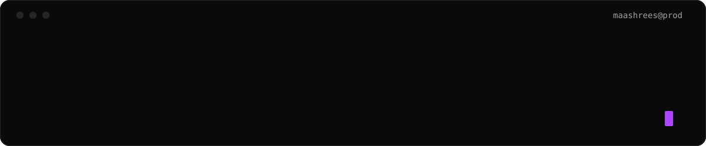
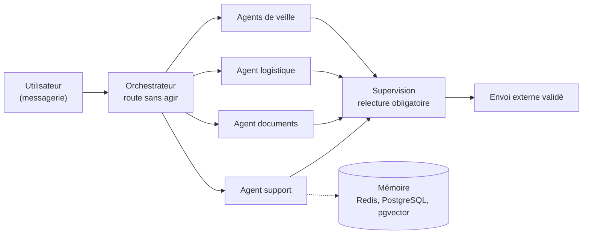
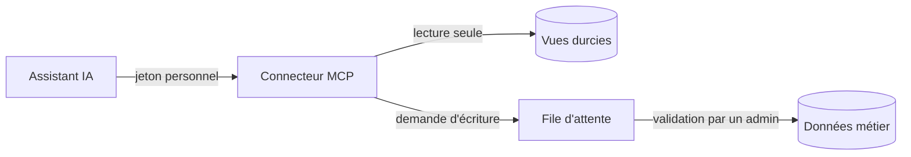
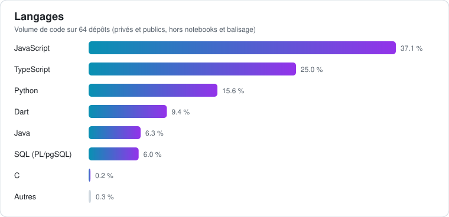
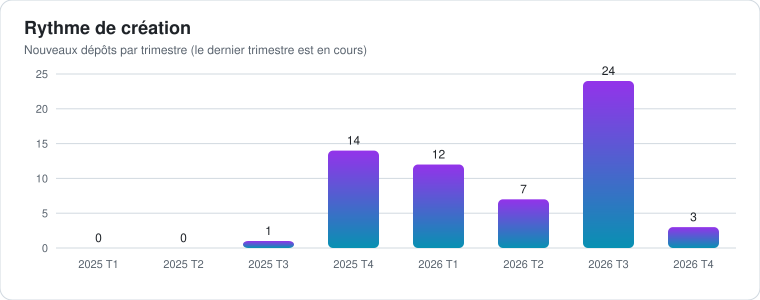
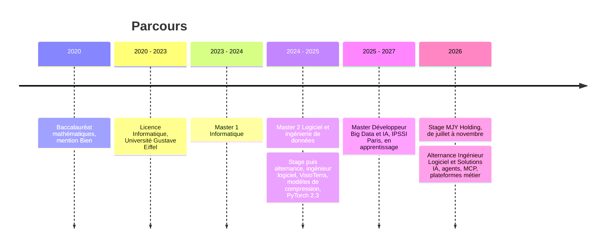

<p align="center">
  
</p>

<p align="center">
  
</p>

<p align="center">
  <a href="https://www.maashrees.com"></a>
  <a href="https://www.linkedin.com/in/seer-mensah-assiakoley-542628198/"></a>
  <a href="mailto:seer.mensaha@maashrees.com"></a>
</p>

```bash
$ whoami
Seer MENSAH-ASSIAKOLEY   # alias maashrees

$ pwd
Paris, France

$ cat mission.txt
Livrer des produits logiciels et des systèmes d'IA qui servent un usage métier réel,
du prototype à la mise en production.

$ ls ~/focus
agents/   mcp/   donnees/   plateformes-metier/   mobile/
```


## 💡 À propos

Ingénieur logiciel, je construis des **solutions d'IA appliquées** et des **plateformes métier** : applications web et mobiles, automatisations, pipelines de données et agents IA branchés sur les outils de l'entreprise. J'opère de bout en bout : cadrage du besoin, architecture, développement, déploiement auto-hébergé, documentation et suivi.

Ma façon de travailler :

- **Partir du besoin métier**, pas de la techno : cadrer, documenter les décisions (ADR), livrer par petits incréments mesurables.
- **Rendre l'IA utile et fiable** : agents supervisés, lecture seule d'abord, validation humaine avant toute action sensible, traçabilité de chaque décision.
- **Livrer pour de vrai** : intégration et déploiement continus, sécurité des données au niveau base, tests et documentation maintenue.


## 🧭 Ce sur quoi je travaille

### 🤖 Solutions IA & agents
Plateforme d'agents IA pour une holding et ses filiales (retail de vélos électriques, restauration) : un orchestrateur qui route sans agir, des agents spécialisés par domaine, une couche de supervision qui relit tout avant envoi externe, une mémoire de travail et une mémoire à long terme. Connecteurs **MCP** pour ouvrir les applications internes aux assistants IA, avec des garde-fous stricts : jetons personnels, écritures validées par un administrateur, lecture seule par défaut. Outil de tickets internes où l'IA propose une priorisation et l'humain décide, avec création automatique d'issues.



Principe des connecteurs MCP : l'assistant n'écrit jamais directement dans les données métier.



### 🏢 Plateformes métier & data
Applications internes pour une holding qui regroupe un réseau de boutiques de vélos électriques et un restaurant : gestion RH et planning, émargement et éléments variables de paie, **réconciliation de stock** à partir d'exports avec relecture assistée par IA, **réconciliation de paiements** entre caisse, plateformes de paiement et comptabilité, commandes fournisseurs et suivi client, SAV et atelier, tableaux de bord de ventes multi-boutiques, gestion de tâches multi-projets avec génération de projets par IA. Pipelines d'import avec quarantaine des données invalides, contrôle d'écarts, et hub de documentation synchronisé automatiquement.

### 📱 Produits web & mobile
Application mobile multiplateforme de mise en relation (Flutter, back-end Spring Boot, paiement en ligne, géolocalisation, notifications, pipeline Python d'analyse), PWA métier, sites vitrines et outils de réservation légers.

### 🧠 Data science & machine learning
Classification de texte par transformers, prédiction de prix, prédiction sportive (XGBoost), graphes de connaissances, vision et OCR, compression de modèles, clonage et traduction de voix, scraping et veille automatisée.

### ⚙️ Infrastructure & automatisation
Hébergement auto-hébergé sur VPS (Coolify, Docker, reverse proxy, HTTPS automatique), workflows **n8n** versionnés, Supabase auto-hébergé, CI GitHub Actions, observabilité (logs centralisés).


## 🛠 Stack technique

<p align="center">
  
</p>

### Utilisation des API d'IA

| API | Ce que j'en fais | Détails |
| :-- | :-- | :-- |
| **API Anthropic** (Claude) | Agents d'orchestration, de domaine et de supervision, analyse de tickets, génération de projets, relecture assistée de rapprochements | L'IA propose, l'humain décide ; relecture avant tout envoi externe |
| **OpenRouter** | Accès à plusieurs modèles par une seule API : vision et conseils personnalisés, traduction | Choix du fournisseur par configuration, avec bascule entre cloud et modèle local |
| **MCP** | Exposer des applications métier aux assistants IA | Lecture seule par défaut, écritures en file d'attente validées, jeton personnel par utilisateur |

### IA & Agents


### Backend & Data


### Frontend & Mobile


### Cloud & DevOps


### Bases solides
C · C++ · Algorithmique · Compilation (Flex/Bison) · Programmation réseau · Systèmes distribués · Architecture microservices


## 📊 En chiffres

Statistiques calculées sur l'ensemble de mes dépôts, privés comme publics (64 dépôts analysés, dont 58 privés).

<p align="center">
  <picture>
    <source media="(prefers-color-scheme: dark)" srcset="assets/langages-dark.svg">
    
  </picture>
</p>

<p align="center">
  <picture>
    <source media="(prefers-color-scheme: dark)" srcset="assets/rythme-dark.svg">
    
  </picture>
</p>

<p align="center">
  
</p>


## 📂 Réalisations

### Professionnelles (détails confidentiels)

| Domaine | Ce que j'ai construit |
| :-- | :-- |
| **Agents IA** | Plateforme d'agents Claude (orchestrateur, agents par domaine, supervision), mémoire Redis et PostgreSQL, intégrations messagerie, documents et courriel, centre de contrôle d'administration |
| **MCP** | Connecteurs pour exposer des applications métier aux assistants IA, avec jeton par utilisateur et file d'écriture validée |
| **RH & paie** | PWA de planning, congés, émargement et préparation de la paie, sécurité des données par rôle et périmètre au niveau base |
| **Stocks & achats** | Réconciliation hebdomadaire du stock avec comptages physiques et avis IA, commandes fournisseurs, suivi de colis et notifications clients |
| **Finance** | Réconciliation de paiements multi-sources avec détection d'écarts |
| **Ventes** | Pipeline d'import, détection d'écarts et tableaux de bord de ventes multi-boutiques |
| **SAV & atelier** | Prise en charge SAV, suivi de réparation et de montage, boîte de réception assistée par IA |
| **Pilotage** | Tickets internes avec priorisation IA, plateforme de tâches multi-projets, hub de documentation synchronisé quotidiennement |
| **Mobile** | Application mobile multiplateforme de mise en relation avec paiement et alertes, et son back-end |
| **Opérations** | Mise en route de vélos avec signature du client et envoi de documents, outil de réservation pour la restauration, déploiement et durcissement de serveurs |

### Projets personnels & produits

| Projet | Description |
| :-- | :-- |
| **Hub capillaire IA** | Catalogue visuel de coiffures avec clustering IA (HDBSCAN, embeddings), OCR, conseils météo et agenda (React, FastAPI, Supabase, n8n) |
| **Vision board 3D** | PWA personnelle où chaque rêve est une étoile dans un ciel 3D interactif, avec étapes, inspirations intégrées et partage depuis les réseaux sociaux (Next.js, Supabase, Docker) |
| **Nutrition & sport** | Journal de repas multimodal (photo et OCR, code-barres, saisie vocale), cibles adaptatives et moteur d'entraînement (React, FastAPI, Supabase) |
| **Agrégateur de plannings** | Centralise Google Sheets, Google Calendar et iCal, détecte les changements d'horaires et notifie |
| **Gouvernance multi-agents** | Un agent supérieur pilote, délègue et génère des sous-agents, avec cockpit de monitoring |
| **Finances personnelles** | Import CSV et Excel multi-banques avec détection de doublons et tableau de bord |
| **Prédiction Coupe du monde 2026** | Modèle XGBoost combinant statistiques de clubs et classements Elo |
| **Planificateur de voyages** | Optimisation d'itinéraire (Haversine), scraping de tarifs et veille des prix |
| **Suivi de candidatures** | Application MERN multi-utilisateur avec JWT, Docker et déploiement sur VPS |
| **Voix** | Clonage de voix en local et traducteur vocal temps réel (Whisper, LLM, synthèse vocale) |
| **Serveur de logs** | Collecte centralisée de logs par API HTTP, image Docker |
| **Portfolios créatifs** | Plusieurs portfolios photo, dont des versions 3D et plein écran (Next.js, Lovable, Figma) |
| **Automatisation** | Bibliothèque de workflows n8n versionnés par domaine |

### Projets de formation & collaboration

| Projet | Description |
| :-- | :-- |
| **Routage de tickets (NLP)** | DistilBERT fine-tuné, API FastAPI conteneurisée, déployée en ligne, F1 pondéré de 0,77 |
| **Graphe de musées** | 137 000 œuvres et leurs artistes dans Neo4j, ETL Joconde et Wikidata, API et carte interactive |
| **Plateforme IA de documents** | Hackathon : traitement de documents administratifs avec Azure Document Intelligence |
| **Semaine immersive IA** | Plateforme de révision personnalisée par IA (React, Python) |
| **Prix Airbnb** | Pipeline scikit-learn servi par API sur 84 000 logements parisiens, front React/TypeScript |
| **Réservation en microservices** | Architecture C4, MongoDB, Cassandra et verrous Redis contre le surbooking |
| **Assistant de garde-robe** | Application React Native, suggestion de tenue par IA selon la météo |
| **Dépenses partagées** | API REST Django/DRF avec JWT et calcul des remboursements minimaux |
| **Scraping e-commerce** | Collecte de données produits |

### Fondamentaux (licence & master)

Compilateur d'un sous-langage C (Flex/Bison), approximation d'images par algorithme génétique en C, compression d'images par réseaux génératifs (PyTorch, TensorFlow, C++), programmation réseau en Java, jeux et solveurs algorithmiques (Snake, Reversi, Boggle, Slitherlink, taquin, voyageur de commerce) en C et programmation fonctionnelle.

### Veille open source

Je suis et expérimente des projets comme le Google Agent Development Kit, n8n-as-code, des skills de prompting pour Claude, des composants cartographiques MapLibre et des templates Streamlit.


## 💼 Expérience

**Ingénieur Logiciel & Solutions IA** · MJY Holding (retail de vélos électriques multi-boutiques et restauration) · alternance · *depuis 11/2026*

- Conception d'une plateforme d'agents IA (orchestrateur, agents de domaine, supervision) et de connecteurs MCP en lecture seule.
- Développement d'applications métier : RH et paie, stocks, réconciliation de paiements, SAV et atelier, tickets internes avec priorisation par IA.
- Déploiement auto-hébergé (VPS, Coolify, Docker), intégration continue, sécurité des données par rôle, documentation et décisions d'architecture.

**Stagiaire Ingénieur Logiciel & Solutions IA** · MJY Holding · stage · *07/2026 – 11/2026*

- Développement d'applications métier internes (RH et planning, SAV et atelier, stocks) et mise en place de l'infrastructure auto-hébergée.
- Premiers automatismes n8n et premières briques de la plateforme d'agents IA.

**Ingénieur logiciel** · VisioTerra · alternance · *10/2024 – 09/2025* · Champs-sur-Marne

- Entraînement de modèles de compression sur images satellites Sentinel-1 (Python, PyTorch, CUDA, OVH Cloud).
- Migration vers PyTorch 2.3 : **-30 % de temps d'exécution**, compression jusqu'à **×250**.
- Scripts de gestion de stockage objet S3, travail en autonomie avec GitLab et Docker.

**Stagiaire ingénieur recherche & développement informatique** · VisioTerra · stage · *05/2024 – 08/2024* · Champs-sur-Marne

- Traitement d'images satellitaires, avec GitLab et Docker.

## 🎓 Formation

- **Master Développeur Big Data & IA** · IPSSI Paris · *2025 – 2027* · en apprentissage
- **Master 2 Logiciel & ingénierie de données** · Université Gustave Eiffel · *2024 – 2025*
- **Master 1 Informatique** · Université Gustave Eiffel · *2023 – 2024*
- **Licence Informatique** · Université Gustave Eiffel · *2020 – 2023*
- **Baccalauréat, spécialité mathématiques, mention Bien** · *2020*




## 🎭 Centres d'intérêt

```bash
$ ls ~/hobbies
theatre/   lecture/   cinema/   dessin/   ecriture/   photographie/   gym/   nature/
```

Théâtre, lecture, cinéma, dessin, écriture et photographie nourrissent ma sensibilité visuelle et narrative (mes portfolios photo en sont la trace). Gym et nature font l'équilibre.


## ✉️ Me contacter

Ouvert aux échanges sur l'IA appliquée, les agents et l'ingénierie logicielle.

[LinkedIn](https://www.linkedin.com/in/seer-mensah-assiakoley-542628198/) · [Portfolio](https://www.maashrees.com) · [Mail](mailto:seer.mensaha@maashrees.com)
